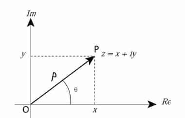

### Representation Methods

The methods are:

- Cartesian representation  
  $z=x+iy$
- Polar representation  
  $z=pe^{i\theta}$

Here:

<Symbols>
  <Sym s="x = p\cos{\theta}">real part</Sym>
  <Sym s="y=p\sin{\theta}">imaginary part</Sym>
  <Sym s="p=\sqrt{x^{2} + y^{2}}">modulus</Sym>
  <Sym s="\theta=\tan^{-1}{(\frac{y}{x})}">arg angle</Sym>
</Symbols>

## Euler's Formula

For $x\in\mathbb{R}$:

$$
e^{ix} = \cos{x} + i\sin{x}
$$

<Proof label="Proof Hint">

Use [Taylor series](/s1/mathematics/real-analysis/taylor-series/#examples) for
$e^x,\cos{x}, \sin{x}$.

</Proof>

## Euler's Identity

One of the most beautiful equations in mathematics.

$$
e^{i\pi} + 1 = 0
$$
