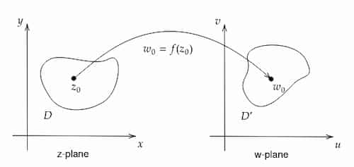

Suppose $w=f(z)$ where $z,w \in \mathbb{C}$. Input and output points are marked
in 2 separate complex planes.

Here:

<Symbols>
  <Sym s="D">domain of $f$</Sym>
  <Sym s="D'">codomain of $f$</Sym>
</Symbols>

### Image

Image of $f$ is the set:

$$
\big\{
f(z)\;|\;z\in D
\big\}
$$

## Cartesian Form

$$
f(z) = u(x,y) + iv(x,y)
$$

Here $u, v$ are real functions.
