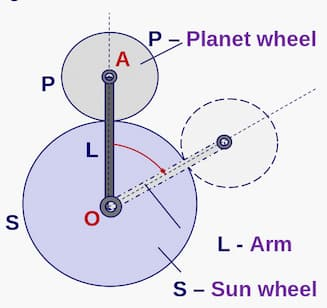
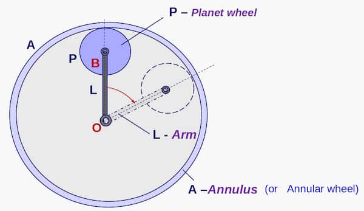

When 2 gears touch:

$$
r_1 \omega_1 = r_2 \omega_2
$$

### Pitch

<Aka>module of the gear wheel</Aka>. Denoted by $m$.

$$
d = mz = 2r
$$

Here:

<Symbols>
  <Sym s="d">pitch circle diameter</Sym>
  <Sym s="m">pitch of the gear</Sym>
  <Sym s="z">no. of teeth in the gear</Sym>
  <Sym s="r">radius of the gear</Sym>
</Symbols>

## Epicyclic Gears

In below equations:

- $\omega_p$ - Absolute angular speed of planet wheel $P$

### External

$$
\omega_p=\Big(1+\frac{r_S}{r_P}\Big)\omega_L - \Big(\frac{r_S}{r_P}\Big)\omega_S
$$

### Internal

$$
\omega_p=\Big(1-\frac{r_A}{r_P}\Big)\omega_L + \Big(\frac{r_A}{r_P}\Big)\omega_A
$$
