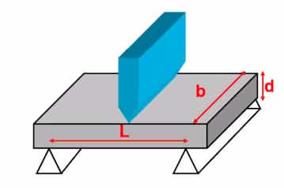

Specimen supported at 2 ends. Load $P$ applied perpendicular at the midpoint (3-point bending) until fracture.

The MOR (Modulus of Rupture) is the maximum stress at the fracture surface:

$$
\text{MOR} = \frac{3PL}{2bd^2}
$$

Here:

<Symbols>
  <Sym s="P">fracture load</Sym>
  <Sym s="L">support span length</Sym>
  <Sym s="b">width of specimen</Sym>
  <Sym s="d">depth of specimen</Sym>
</Symbols>

MOR is equivalent to the tensile strength in bending, not in pure tension.

## Failure Mode

Brittle materials fracture on the tension side (bottom face). Tensile stress exceeds compressive stress at fracture for materials with no plastic deformation.

## Comparison to Tensile Test

Brittle materials (ceramics, glass) are difficult to grip without introducing stress concentrations in a tensile test. The flexural test avoids this: the specimen is simply supported and loaded in bending, making it the standard test for brittle materials.
