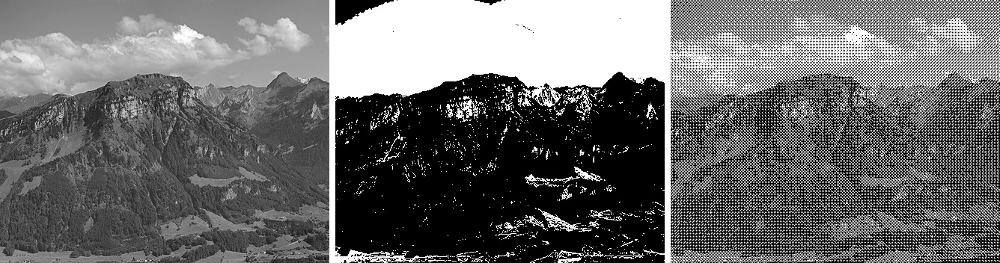

Dithering trades spatial resolution for grey-level depth. A device with few output levels approximates an intermediate intensity by mixing the available levels over a small region, which the eye averages at normal viewing distance.

- Each pixel is divided into sub-pixels, each forced to an available level
- The count of sub-pixels at the higher level encodes the target intensity
- A fixed dither matrix sets the order in which sub-pixels switch on, spreading them to avoid visible clumps

Used in newspaper halftoning, laser printing, and exporting photos to a small fixed palette such as GIF.

<figure>

<figcaption>

Left: Original. Middle: Reduced to 2 levels by a single threshold, which loses most of the tones. Right: Reduced to 2 levels with an $8 \times 8$ Bayer dither matrix, where the density of white dots recovers the tones.  
Generated from a photo by [Hannes Röst](https://commons.wikimedia.org/wiki/File:Fronalpstock_big.jpg), CC BY-SA 3.0.

</figcaption>

</figure>

## Worked Example

A bi-level device with output levels $0$ and $1$. Target intensity $v = 0.5$ across one $2 \times 2$ block, using the Bayer dither matrix.

$$
D = \begin{bmatrix} 0 & 2 \\ 3 & 1 \end{bmatrix}
$$

<Solution>

Sub-pixel $(i,j)$ is set to $1$ **iff** $v > \dfrac{D_{ij} + 0.5}{4}$.

- $(0,0)$ has threshold $0.125$. Since $0.5 > 0.125$, set to $1$.
- $(0,1)$ has threshold $0.625$. Since $0.5 < 0.625$, set to $0$.
- $(1,0)$ has threshold $0.875$. Since $0.5 < 0.875$, set to $0$.
- $(1,1)$ has threshold $0.375$. Since $0.5 > 0.375$, set to $1$.

2 of the 4 sub-pixels are on, so the block averages $0.5$, matching the target. The on sub-pixels form a checkerboard.

<DitherBlockDiagram />

</Solution>
